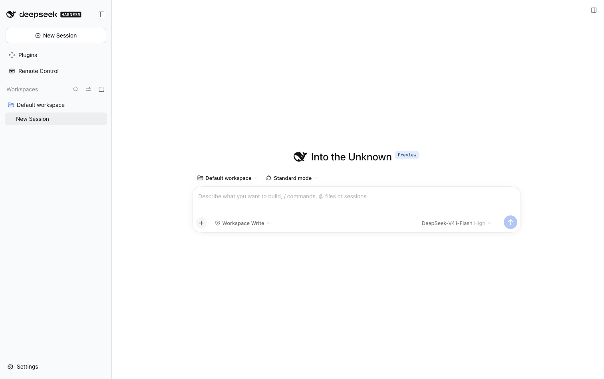
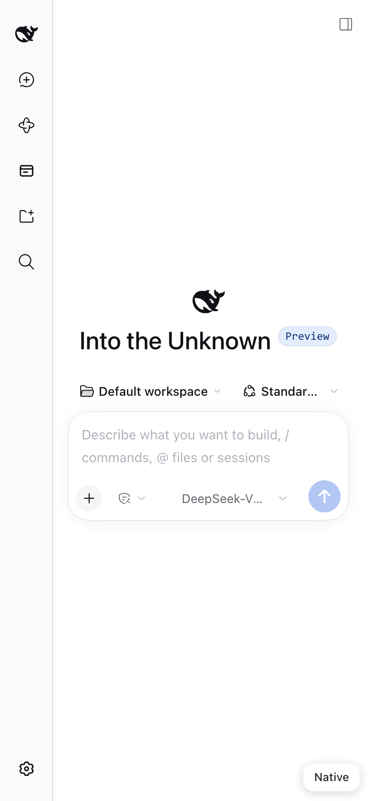
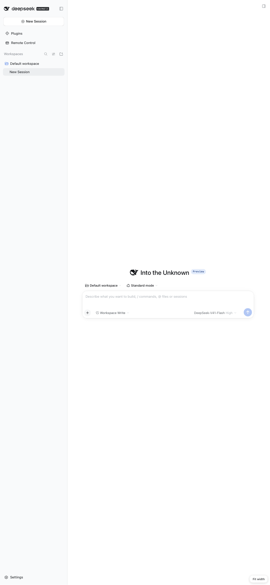
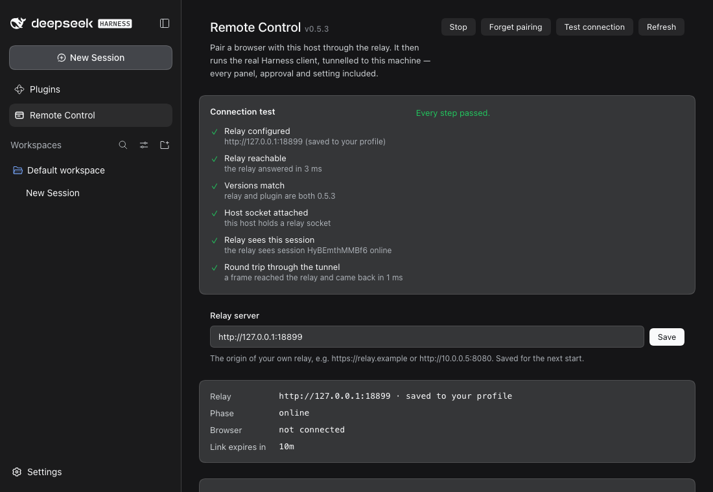
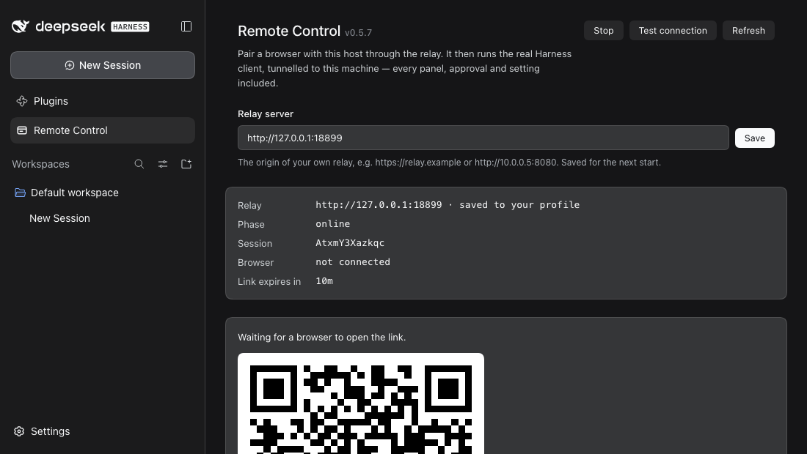

# dsh-remote-control

The real DeepSeek Harness client, tunnelled from any browser through one outbound WebSocket to a relay.
**English** | [简体中文](README.zh-CN.md)

[](LICENSE)
[](https://github.com/icrefin/dsh-remote-control/releases)
[](https://github.com/icrefin/dsh-remote-control/actions/workflows/ci.yml)
[](https://github.com/icrefin/dsh-remote-control/commits/main)
[](https://github.com/icrefin/dsh-remote-control/stargazers)
[](.github/CONTRIBUTING.md)
[](https://nodejs.org)
[](https://github.com/deepseek-ai/deepseek-harness)

Drive this DeepSeek Harness host from any browser — a phone, a tablet, another
desktop — and get **the real Harness client**, not a cut-down remote control.

The plugin opens one outbound WebSocket to a relay and then does nothing clever:
the relay reverse-proxies the browser's HTTP and WebSocket traffic down that
socket, and the host replays it against its own loopback web server. The bytes
the remote browser sees are the bytes the local GUI sees. Sessions, approvals,
`ask_user` prompts, files, the terminal, settings, plugins, live token
streaming: all of it arrives by construction, and none of it needed a line of
code here.

| Desktop browser | Phone — native reflow | Phone — "Fit" (desktop layout) |
|---|---|---|
|  |  |  |

## Why proxying, and not a mobile UI

Earlier revisions of this plugin built a small mobile SPA and a method table
(`sessions.list`, `session.transcript`, `approval.respond`, …) behind it. Every
slice of the GUI it re-implemented was wrong in a new way: the sidebar did not
match, approvals arrived late, streaming text did not stream. A remote control
built from the outside is always a subset, and a subset is always out of date.

Proxying the actual client retires that entire class of bug. The trade is that
the relay now terminates the browser's plaintext traffic instead of forwarding
opaque frames — see [Security](#security).

## Install

**The plugin and the relay are one versioned pair.** Deploy them together: the
plugin calls `/_relay/*` and expects the tunnel framing in `PROTOCOL.md` §3, so a
new plugin against an old relay cannot register at all, and an old relay serves
its HTML shell for the paths the plugin asks for. `GET /healthz` reports the
relay's `version`, which is the fastest way to see a skew.

```sh
pnpm install
pnpm check          # typecheck both halves, build, run 62 tests
scripts/install.sh  # pack, then print how to install dist/dsh-remote-control-<version>.tgz
```

Install the tarball through the plugin manager (sidebar → 插件) and restart.
Adding a bundle to a running profile always needs a restart, and reinstalling
the same version is a silent no-op — bump the version or remove the bundle
first.

### The relay

Your machine dials **out** to a relay, and browsers reach your machine through
it — so you need one running somewhere both sides can reach. It is a
dependency-light Node program, and it ships inside this package under
[`relay/`](relay), with its own deployment guide:

```sh
cd relay && npm install --omit=dev
PORT=8080 PUBLIC_ORIGIN=http://relay.example node server.mjs
```

On a systemd host, `relay/install.sh` does the whole job — service account,
`/opt/dsh-relay`, dependencies, environment file, unit and start:

```sh
sudo ./relay/install.sh --public-origin https://relay.example
```

Then type that origin into the **Relay server** field at the top of the Remote
Control panel and press **Save**. That is all most people need.

**There is deliberately no default relay.** A relay is somebody's server, so
this plugin ships with none; until you name one, the panel says so rather than
dialling a stranger. Read [`relay/README.md`](relay/README.md) for TLS, upgrades,
the full environment reference and troubleshooting.

### The Relay server setting

The field writes through the harness **settings service**, so the value lands in
your profile's `cordis.patch.yml` — the same user layer the app's own settings
pages write to — and is reapplied to this plugin at the next boot. Nothing is
stored twice: this plugin keeps no copy of its own, and the value it reads back
is the live config field the loader maintains.

Precedence, highest first:

| Source | Shown as | Editable in the panel |
|---|---|---|
| `DSH_REMOTE_RELAY` in the environment | *from DSH_REMOTE_RELAY* | no — the field is disabled |
| everything else | *saved to your profile* | yes |

The environment wins because it is a deployment's own instruction, and the field
is disabled rather than silently ignored when it is set.

There is deliberately no distinction between "saved from the panel" and "typed
into the profile patch": both are the same user layer of the same file, so a
panel that pretended otherwise would be inventing a state it cannot see. Type
the origin in whichever place you prefer — the panel is simply the one that
saves it for you.

Saving while the link is armed **restarts it against the new origin**
immediately, so the QR you are looking at is the one that works.

An origin is validated before it is stored: `http:` or `https:`, origin only, no
path. Anything else is refused with the reason, and the stored value is left
alone.

### Test connection

When something is wrong the symptom is usually the same from the phone — an
offline page — while the cause can be any link in the chain. **Test connection**
walks it and names the one that broke:



| Step | What it proves |
|---|---|
| Relay configured | an origin is set, and it is an http(s) origin |
| Relay reachable | the relay answers `/healthz`, and how fast |
| Versions match | the relay's reported version equals this plugin's — the skew that otherwise only shows up as a pairing page that will not finish |
| Host socket attached | this host actually holds a relay socket |
| Relay sees this session | the relay reports *this* session online, not just any host |
| Round trip through the tunnel | a frame goes host → relay → host through the real tunnel and comes back, timed |

Steps that cannot run because an earlier one failed are reported as skipped
rather than red, so a single broken link does not read as six. The last step is
the one that matters most: an open socket can look healthy while frames are
going nowhere, and only a round trip proves otherwise.

### If pairing does not get past the spinner

A pairing token is **single-use**, and the page that carried it keeps it in the
address bar. Reloading that page, or opening the link twice, therefore presents
a token the relay has already burned. The relay says so and the page offers
**Try another link** — mint a fresh one from the panel. Nothing needs
restarting, and no state is stuck.

Two other dead ends are diagnosed on the page rather than left spinning: a relay
that answers with HTML instead of JSON (version skew) and a host that never
attaches (the plugin is not armed, or the Harness is not running). Both are
bounded — the pairing page never waits forever.

## Use

The panel carries the installed version and the author credit beside its title —
`v0.9.7 Author: icrefin [icrefinai@gmail.com]` — the way the other plugins here
do.

**Start and Stop are the whole model.** Start opens an outbound connection to
the relay and pairs a browser to this host; Stop ends that pairing. Stopping is
also how a leaked link is revoked, so it does not pause — it finishes the
session, and browsers holding it must pair again.

**A restart is not a Stop.** Restarting the app resumes the same session, so a
browser that is already paired keeps working; the identity is remembered for
exactly that reason, and the teardown that a reload, an upgrade or a shutdown
runs closes the socket *without* revoking the pairing. Without that, every
restart would silently cut off the browsers that were already paired, and the
first thing you would see is the relay's pairing page with nothing on screen to
explain it.

### Where the relay secret lives

In its own file, `~/.dsh/relay-secret`, and **not** in the profile document. A
secret is a credential, not configuration: that document is rewritten by the
settings service whenever anything else in the row changes, it is the file an
operator opens to read their setup, and on this host it was already being
clobbered by a running build that did not know the field. The file is written
`0600`, holds nothing but the secret, and is read on every use — so a secret
corrected by hand or by a provisioning script takes effect at once, with no
restart.

The panel shows that file's contents — masked, with an eye to reveal it — so
the value in use can be read and corrected without leaving the app. There is no
environment variable for it: one was tried, and it silently outranked the panel,
so an edit in the UI could have no effect.

To give another host the same access, copy that one file:

```bash
scp ~/.dsh/relay-secret other-host:~/.dsh/relay-secret
```

### Two lifetimes, and only one of them is short

The panel's countdown is easy to misread, so it is worth being exact:

| | Lifetime | Why |
|---|---|---|
| The **link** (the QR, `?t=…`) | 10 minutes, single use | It is a bearer credential in a URL. You may have screenshotted it, mailed it, or shown it across a room. Short and single-use means a leak is worth almost nothing a minute later. The panel re-mints one every time it is opened, so the QR on screen is always live. |
| The **pairing** (the browser's cookie) | a year | This is the thing that should persist. It survives restarting the app, updating it, and restarting the relay, because both the session and the browser's token are written down on the relay's side. |

So a browser pairs **once**. It keeps working because the host resumes the same
session, which is why the host writes its identity down at all. The pairing is
only broken by a deliberate **Stop**, by the host losing its identity, or by the
relay dropping that browser's token because fifty other browsers paired while it
was idle — and in every one of those cases the browser is told which happened and
offered a fresh link, rather than left guessing.



1. Open **Remote Control** in the Harness sidebar.
2. Press **Start**. The host connects out to the relay and a QR appears.
3. Scan it with a phone camera — or open the link in any browser.
4. The browser loads the Harness. That is the whole flow.

Stopping finishes the session rather than pausing it: the host tells the relay,
discards its own identity, and the old URL — and every browser holding a cookie
for it — is done. Starting again mints a fresh session and a fresh QR.

**A restart is not a stop.** Restarting the app resumes the same session, so a
browser that is already paired keeps working — the identity is remembered for
exactly that reason. Only Stop, a pair the relay no longer recognises, or a
browser the relay had to drop when the session reached its limit, requires
pairing again.

To take a paired browser back out without touching the host,
`POST /_relay/unpair` clears its cookie.

## Remote display

The shipped client is built for a desktop viewport. It already collapses its
sidebar to a rail when it is narrow, so a phone is usable unaided — but three
things still needed fixing, and the host injects a small payload into the
tunnelled shell to fix them:

| Concern | What the payload does |
|---|---|
| keyboard | `interactive-widget=resizes-content`, so a soft keyboard shrinks the layout instead of covering the composer |
| scaling | below 1120 px it offers **Fit** — the full desktop layout at the design width, fitted to the screen — and **Native**, the client's own reflow. The choice is remembered per device |
| gestures | `touch-action: manipulation` keeps pinch-zoom and drops double-tap zoom |

The switcher is a `position: fixed` button that renders only below the design
width, and switching rewrites the viewport meta on the live document rather than
reloading, so an open conversation survives the change.

The payload is applied **only to tunnelled responses**. A browser running on the
host itself never sees it, which is why the local GUI is byte-identical to what
it was before this plugin was installed.

## Routes

The `/api/dsh-remote-control` family is the operator's local control surface. Every
route is loopback-only, and the mutating ones require `POST`.

| Route | Method | Purpose |
|---|---|---|
| `/api/dsh-remote-control/status` | GET | phase, relay, pairing URL, tunnel counters |
| `/api/dsh-remote-control/start` | POST | arm the link, open the device socket |
| `/api/dsh-remote-control/stop` | POST | end the pairing: close the link, tell the relay, discard the identity |
| `/api/dsh-remote-control/pair` | POST | mint a fresh pairing token |
| `/api/dsh-remote-control/qr.svg` | GET | the pairing URL as an SVG QR |
| `/api/dsh-remote-control/settings` | POST | store the relay origin, and re-target a running link |
| `/api/dsh-remote-control/test` | POST | run the connection test and return its report |
| `/api/dsh-remote-control/trace` | GET | recent link traffic |

The panel asks for these routes **relative to the document** (`CLIENT_API`,
derived from `API` by `clientPath()` in `src/protocol.ts`); the route table above
stays absolute because that is what the web server matches. The distinction is
load-bearing here more than anywhere else: this plugin serves the web client at
`/s/<sessionId>/`, so an origin-absolute `/api/…` request from the panel's own
page leaves that scope and is answered by the relay's pairing page — a
`200 text/html` body, which the panel would report as `Unexpected token '<'`
rather than as an HTTP failure. `test/protocol.spec.ts` resolves both forms
against a tunnelled base to pin it.

## Performance

A cold load of the client is ~12 MB of JavaScript. The tunnel keeps the origin's
compression for subresources, so that crosses the wire as ~6 MB; only a document
navigation drops `accept-encoding`, because the shell's HTML has to be readable
to splice in the display payload. Measured end to end through a public relay:
first paint at ~12 s cold, and the browser's own cache does the rest.

## Security

**The pairing URL is a credential.** Anyone who opens it reaches this host. That
is why:

- the URL is redacted (`hash=***`) in every log line;
- the QR route and the status route send `cache-control: no-store`;
- the pairing token is single-use and expires (default 10 min);
- the browser cookie the relay issues is `HttpOnly`, `SameSite=Lax`, and
  `Secure` behind TLS.

**The harness credential never leaves the host.** The browser-session cookie the
Harness requires is minted *on the host*, bound to `127.0.0.1:<port>`, and
injected into the loopback replay. Neither the browser nor the relay ever sees
it, so a compromised relay cannot replay it against this machine's API.

**The relay does see your traffic.** It terminates the browser's HTTP, so it can
read every request and response in plaintext unless you put TLS in front of it.
That is a real change from an opaque frame forwarder, and it is the price of
serving the real client through a relay. If it is not acceptable, run the relay
on a host you control, or terminate TLS at a reverse proxy you control. The
stored state is one JSON file (`hostSecret`, phone tokens, pairings), written
`0600`.

## Environment overrides

| Variable | Effect |
|---|---|
| `DSH_REMOTE_RELAY` | relay origin the host dials; overrides the row's `relay` config |
| `DSH_HOME` | where the durable pairing identity is stored |

Relay-side: `PORT`, `HOST`, `STATE_FILE`, `WEB_ROOT`, `PUBLIC_ORIGIN`,
`PAIRING_TTL_MS`, `TUNNEL_HEAD_TIMEOUT_MS`, `TUNNEL_OPEN_TIMEOUT_MS`,
`BROWSER_IDLE_MS`, `DEBUG=1` (frame-level tracing).

## Layout

```
src/
  index.ts                 host half: link, tunnel, cookie, routes
  protocol.ts              local panel contract, shared by both halves
  routes.ts                the /api/dsh-remote-control family + loopback fence
  relay/hostLink.ts        relay transport: registration, pairing, reconnects
  web/replay.ts            the tunnel: loopback HTTP + WebSocket replay
  web/adapt.ts             the injected remote-display layer
  client/                  sidebar panel: QR, status, tunnel health
relay/
  server.mjs               reverse proxy, pairing shell, session table
  web/                     the pairing shell (index.html, pair.js, pair.css)
  PROTOCOL.md              the whole wire contract
scripts/dev-profile.sh     boot the plugin in an isolated profile
scripts/ui-shot.mjs        headless screenshot/DOM probe for UI work
```

The published tarball carries `relay/` as well as `lib/`, so a relay can be stood
up from the same artifact that installed the plugin.

## Versioning

The plugin and the relay are released from one repository and have to be able to
talk to each other, so they share a **compatibility line**: the first two digits
of the version. The rule is mechanical.

| The change | Bump | Both sides? |
|---|---|---|
| Touches the relay, or the contract between the halves | **minor** — `0.9.x` → `0.10.0` | yes, both move together |
| Touches the plugin alone | **patch** — `0.9.1` → `0.9.2` | plugin only; the relay keeps its version |
| Touches the relay alone | **patch** | relay only; the plugin keeps its version |

So any plugin on `0.9.*` works with any relay on `0.9.*`: `0.9.1`, `0.9.2` and
`0.9.9` are all the same line, and the connection test compares that line rather
than the whole version. A `major` bump means the halves are no longer expected to
interoperate at all.

`test/bundle.spec.ts` asserts the two package manifests agree on the line, so a
release cannot drift out of it by accident.

## Verification

Four tiers, weakest to strongest:

```sh
pnpm check                  # typecheck, build, 62 unit + integration tests
node relay/verify.mjs       # 27 checks: the relay contract, no DSH needed
node relay/e2e.mjs --dsh http://127.0.0.1:19499 --token <from `dsh web`>
                            # 24 checks: real browser, real relay, real harness
```

1. **Unit** — the tunnel's header rewriting, cookie refresh, body streaming,
   injection idempotence, socket backlog and error paths, against a real
   loopback HTTP/WebSocket server.
2. **Integration** — `HostLink` against a **real relay process**: registration,
   the pairing cookie, tunnelled requests and bodies, `502` on host failure,
   `503` on a detached host, presence, identity persistence, and a clear error
   when the relay answers with HTML instead of its API.
3. **Contract** — `relay/verify.mjs` drives every route and upgrade the relay
   owns, with a stub host, so a failure is always the relay's.
4. **End to end** — `relay/e2e.mjs` pairs headless Chrome through a real relay
   against a running `dsh web`, then asserts what the page rendered at desktop
   width, at phone width, and after switching to Fit. It also re-opens a spent
   pairing link and requires a clear error step, because "the token was already
   used" must never look like "pairing is broken". It writes the three
   screenshots at the top of this file.

Tier 4 exists because tiers 1–3 can agree while the product is still broken: the
page has to actually render, and only a browser can say whether it did.

Two bugs found this way, both invisible to the lower tiers: the plugin resolved
`ctx.connection` at mount time and so never minted a cookie at all (the tunnel
returned `socket hang up`), and a retried request was rebuilt but never ended, so
it was constructed and never sent.

## History

This plugin began as a ZCode-compatible client: it spoke Zhipu's relay protocol,
reproduced their HMAC handshake, and reimplemented the subset of the ZCode agent
RPC surface their phone page required. That work is preserved rather than
deleted, because the protocol archaeology is still accurate:

- [`scripts/phone-sim.mjs`](scripts/phone-sim.mjs) — drives ZCode's own phone page
  headlessly over the DevTools protocol, which is how their boot sequence was
  observed instead of guessed.
- [`docs/dsh-host-api-reference.md`](docs/dsh-host-api-reference.md) — the
  verified `ctx.*` surface a hand-built remote control needs. Superseded, and
  labelled as such, because the premise no longer holds.

The analysis behind that earlier design stays in the maintainer's notes; what
survived into this repository is the verified API reference above.

## Provenance

Not affiliated with or endorsed by Zhipu. No ZCode code or protocol is used by
the current implementation.

## Contributing

Issues and pull requests are welcome — see [CONTRIBUTING.md](.github/CONTRIBUTING.md)
for the development setup and the sign-off expectation. Please report security
issues privately as described in [SECURITY.md](.github/SECURITY.md).

## License

MIT — see [LICENSE](./LICENSE).

> If driving this host from your phone saves you a trip to the desk, a ⭐ star helps other DSH users find it.
