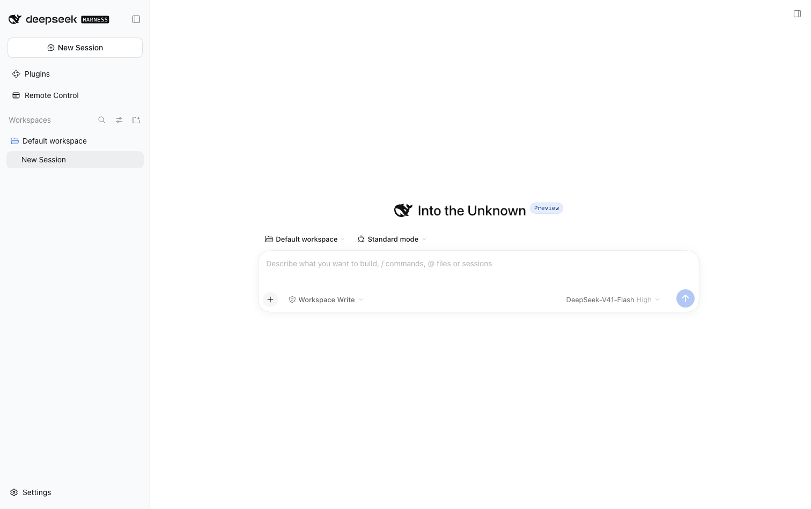
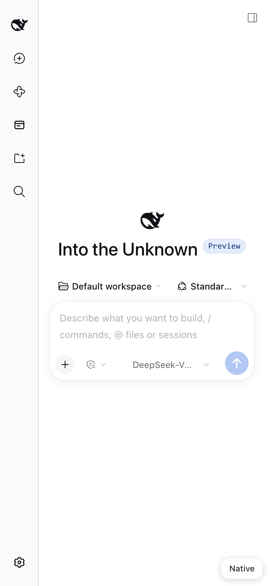
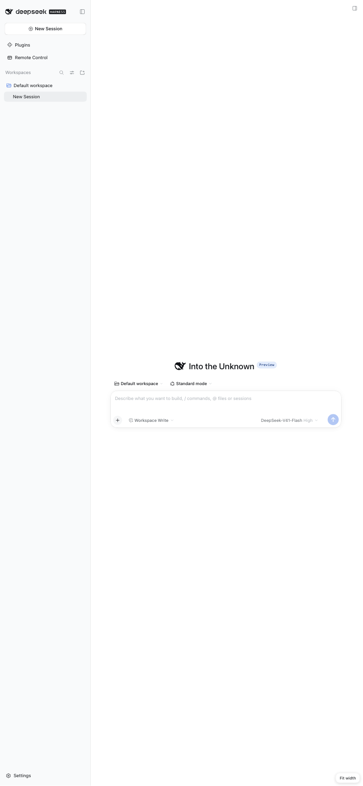
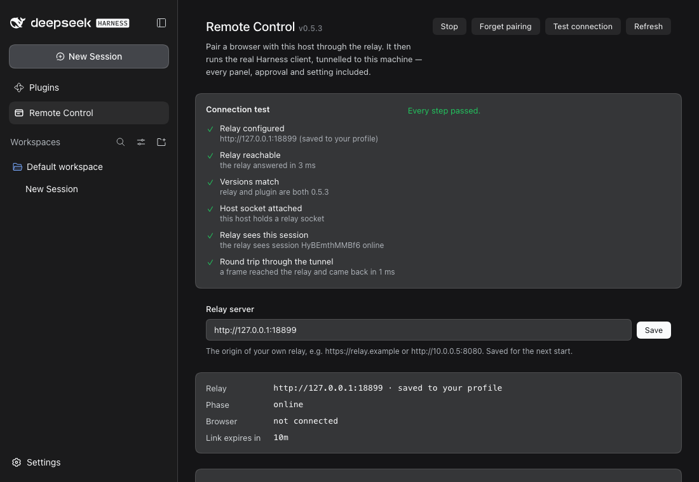
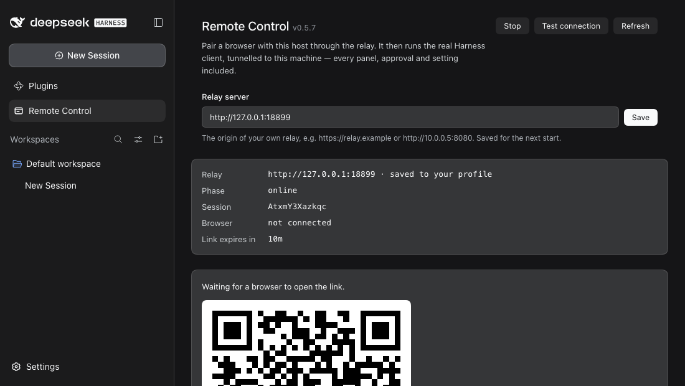

# dsh-remote-control

真正的 DeepSeek Harness 客户端：从任意浏览器出发，经一条出站 WebSocket 隧道接入中继。
[English](README.md) | **简体中文**

[](LICENSE)
[](https://github.com/icrefin/dsh-remote-control/releases)
[](https://github.com/icrefin/dsh-remote-control/actions/workflows/ci.yml)
[](https://github.com/icrefin/dsh-remote-control/commits/main)
[](https://github.com/icrefin/dsh-remote-control/stargazers)
[](.github/CONTRIBUTING.md)
[](https://nodejs.org)
[](https://github.com/deepseek-ai/deepseek-harness)

从任意浏览器——手机、平板、另一台桌面——驱动这台 DeepSeek Harness 主机，拿到的是
**真正的 Harness 客户端**，而不是一个被裁掉大半的遥控器。

插件向中继打开一条出站 WebSocket，此后不做任何取巧的事：中继把浏览器的 HTTP 与
WebSocket 流量反向代理到这条 socket 上，主机再把它重放到自己的回环 web 服务器。
远端浏览器看到的字节，就是本地 GUI 看到的字节。会话、审批、`ask_user` 提问、文件、
终端、设置、插件、token 流式输出：全由架构本身保证，本插件一行代码都没为它们写。

| 桌面浏览器 | 手机 —— 原生重排 | 手机 —— “Fit”（桌面布局） |
|---|---|---|
|  |  |  |

## 为什么是反向代理，而不是移动端 UI

这个插件更早的版本自带一个小型移动端 SPA，后面挂着一张方法表（`sessions.list`、
`session.transcript`、`approval.respond`、…）。它重新实现的每一块 GUI，都以一种新的
方式出错：侧边栏对不上，审批来迟了，流式文本不流。从外部搭起来的遥控器注定是一个
子集，而子集注定会过时。

代理真实客户端，让这一整类缺陷直接退休。代价是：中继现在终结浏览器的明文流量，
而不是转发不透明的帧——见[安全](#安全)。

## 安装

**插件和中继是一对同版本发布的组件。** 请一起部署：插件调用 `/_relay/*`，并期待
`PROTOCOL.md` §3 里规定的隧道封装，所以新插件配旧中继根本注册不上，而旧中继会在
插件请求的路径上返回它自己的 HTML 外壳。`GET /healthz` 会报告中继的 `version`，
这是发现版本错位最快的办法。

```sh
pnpm install
pnpm check          # typecheck both halves, build, run 62 tests
scripts/install.sh  # pack, then print how to install dist/dsh-remote-control-<version>.tgz
```

通过插件管理器（侧边栏 → 插件）安装这个 tarball，然后重启。往正在运行的 profile 里
添加 bundle 总是需要重启；而重装同一个版本等于什么都没做——先把版本号往上提，或者
先把这个 bundle 移除。

### 中继

你的机器向中继**出站**拨号，浏览器再经由中继抵达你的机器——所以你得在一个两边都能
到达的地方跑一个中继。它是个依赖很少的 Node 程序，就随本包发布在
[`relay/`](relay) 下，并带有自己的部署指南：

```sh
cd relay && npm install --omit=dev
PORT=8080 PUBLIC_ORIGIN=http://relay.example node server.mjs
```

在 systemd 主机上，`relay/install.sh` 一次做完所有事——服务账号、`/opt/dsh-relay`、
依赖、环境文件、unit 和启动：

```sh
sudo ./relay/install.sh --public-origin https://relay.example
```

然后把这个 origin 填进 Remote Control 面板顶部的 **Relay server** 字段，按
**Save**。大多数人到这一步就够了。

**这里刻意不设默认中继。** 中继是别人的服务器，所以本插件一个都不预置；在你指定
之前，面板只会说明这一点，而不会去拨一台陌生的机器。TLS、升级、完整的环境变量
参考与故障排查，见 [`relay/README.md`](relay/README.md)。

### Relay server 设置

这个字段经由 harness 的 **settings service** 写入，所以值落在你 profile 的
`cordis.patch.yml` 里——也就是应用自己的设置页所写的同一个用户层——并在下次启动时
重新应用到本插件。没有任何东西存两份：本插件自己不留副本，它读回的值就是 loader
维护的那个实时配置字段。

优先级从高到低：

| 来源 | 显示为 | 面板中可编辑 |
|---|---|---|
| 环境里的 `DSH_REMOTE_RELAY` | *from DSH_REMOTE_RELAY* | 否 —— 字段被禁用 |
| 其他一切 | *saved to your profile* | 是 |

环境变量优先，因为它代表这次部署自己的指令；一旦设置了它，字段就被禁用，而不是被
悄悄忽略。

这里刻意不区分「从面板保存」和「直接写进 profile patch」：它们本来就是同一个文件的
同一个用户层，面板若假装有别，就等于凭空造出一个它看不见的状态。你愿意在哪写
origin 都行——面板只是那个替你保存的地方。

在链路已布防时保存，会立刻**用新 origin 重启它**，所以你眼前这个二维码就是能用
的那一个。

origin 在存储前会先校验：只接受 `http:` 或 `https:`，只允许 origin，不带路径。其他
一律拒绝并给出原因，已存的值保持原样。

### 测试连接

出问题时，从手机上看症状通常都一样——一个离线页面——而原因可能是链条上的任何一环。
**Test connection** 会逐环走一遍，并指出断在哪一环：



| 步骤 | 它证明了什么 |
|---|---|
| 中继已配置 | 已设置 origin，且是 http(s) origin |
| 中继可达 | 中继能应答 `/healthz`，以及应答多快 |
| 版本一致 | 中继报告的版本与本插件相同——这种错位否则只会表现为一个永远走不完的配对页 |
| 主机 socket 已挂上 | 本主机确实持有一条中继 socket |
| 中继看得见本会话 | 中继报告在线的是*这个*会话，而不只是某台主机 |
| 经隧道的往返 | 一帧经由真实隧道走 host → relay → host 再回来，并计时 |

因为前面某一步失败而无法运行的步骤，会报成跳过而不是红色，所以一处断裂不会被读成
六处。最后一步最要紧：一条已打开的 socket 可以看上去很健康，而帧其实哪儿都没去，
只有往返才能证明不是这样。

### 如果配对过不了转圈这一步

配对 token 是**一次性**的，而承载它的页面会把它留在地址栏里。因此刷新那个页面、或者
把链接打开两次，出示的就是中继已经烧掉的 token。中继会如实说明，页面则给出
**Try another link**——从面板上重新生成一个。什么都不用重启，也没有状态卡住。

另外两种死路会在页面上直接诊断出来，而不是让你看着它一直转：中继用 HTML 而不是
JSON 应答（版本错位），以及主机始终没有挂上（插件未布防，或者 Harness 没在运行）。
两者都有上界——配对页从不无限等待。

## 使用

面板标题旁边带着已安装的版本和作者署名
（`v0.9.7 Author: icrefin [icrefinai@gmail.com]`），和这里的其他插件一样。

**Start 与 Stop 就是全部模型。** Start 向中继打开一条出站连接，并把一个浏览器配对到
本主机；Stop 结束这次配对。撤销一条泄漏的链接也是靠 Stop，所以它不是暂停——它把
会话了结，持有它的浏览器必须重新配对。

**重启不是 Stop。** 重启应用会续上同一个会话，所以已经配对的浏览器照样能用；身份被
记住，原因正在于此——而一次重载、升级或关停所执行的下线清理，关闭 socket 时**不**
吊销配对。否则每次重启都会悄悄切断已配对的浏览器，而你第一眼看到的会是中继的配对页，
屏幕上没有任何东西解释它。

### 中继密钥放在哪里

放在它自己的文件里，`~/.dsh/relay-secret`，**不**在 profile 文档里。密钥是凭据，不是
配置：那份文档每次这一行里别的什么变动都会被 settings service 重写，它是运维人员
打开来读自己配置的那个文件，而且在这台主机上，它已经被一个根本不认识这个字段的
运行中构建覆写过。这个文件以 `0600` 写入，除密钥外不存别的东西，每次使用都重新读取
——所以无论手工改还是由置备脚本改，改完立刻生效，不用重启。

面板会显示这个文件的内容——打码，带一个眼睛图标可以揭开——所以在用的值可以直接读出
并改正，不必离开应用。它没有环境变量：曾经加过一个，结果它悄悄压过面板，于是 UI 里的
修改可能毫无效果。

要让另一台主机获得同样的访问权，把这一个文件拷过去：

```bash
scp ~/.dsh/relay-secret other-host:~/.dsh/relay-secret
```

### 两种寿命，其中只有一种很短

面板上的倒计时很容易被误读，所以这里说准确些：

| | 寿命 | 原因 |
|---|---|---|
| **链接**（二维码，`?t=…`） | 10 分钟，一次性 | 它是装在 URL 里的 bearer 凭据。你可能截过图、发过邮件，或隔着房间展示过。短且一次性意味着，泄漏一分钟之后几乎一文不值。面板每次打开都会重新生成一条，所以屏幕上的二维码永远是活的。 |
| **配对**（浏览器的 cookie） | 一年 | 这才是应该持久的东西。重启应用、升级应用、重启中继都不影响它，因为会话和浏览器的 token 都记在中继那一侧。 |

所以一个浏览器只配对**一次**。它能一直用，是因为主机续上了同一个会话——主机把自己
的身份写下来，为的正是这个。配对只会被三种情况打断：一次刻意的 **Stop**、主机丢失
自己的身份，或者中继丢掉了那个浏览器的 token（因为在它闲着的这段时间里，又有五十个
别的浏览器配了对）——而无论哪一种，浏览器都会被告知发生了什么、并给出一条新链接，
而不是被丢在那里自己猜。



1. 在 Harness 侧边栏打开 **Remote Control**。
2. 按 **Start**。主机向中继出站连接，然后出现一个二维码。
3. 用手机相机扫它——或者用任意浏览器打开这条链接。
4. 浏览器加载出 Harness。整个流程就这些。

Stop 是把会话了结，而不是暂停：主机通知中继、丢弃自己的身份，旧 URL——以及每一个
持有它 cookie 的浏览器——就此作废。再 Start 会生成一个新会话和一个新二维码。

**重启不是一次 Stop。** 重启应用会续上同一个会话，所以已经配对的浏览器照常能用——身份
被记住，为的正是这个。只有 Stop、中继不再认识的配对，或者会话达到上限时中继不得不
丢掉的浏览器，才需要重新配对。

要在不碰主机的情况下把一个已配对的浏览器摘掉，用 `POST /_relay/unpair` 清掉它的
cookie。

## 远端显示

随包发布的客户端是按桌面视口构建的。它在窗口变窄时本来就会把侧边栏收成一条窄栏，
所以手机上不加干预也能用——但仍有三件事需要修，主机往隧道里的外壳注入一小段
payload 来修它们：

| 问题 | payload 做了什么 |
|---|---|
| 键盘 | `interactive-widget=resizes-content`，软键盘于是压缩布局，而不是盖住输入框 |
| 缩放 | 低于 1120 px 时提供 **Fit**——按设计宽度铺开的完整桌面布局，缩放到屏幕上——以及 **Native**，即客户端自己的重排。选择按设备记住 |
| 手势 | `touch-action: manipulation` 保留双指缩放，去掉双击缩放 |

切换器是一个 `position: fixed` 按钮，只在设计宽度以下才渲染；切换时改的是当前文档
上的 viewport meta，而不是重新加载，所以进行中的对话能跨过这次切换。

这段 payload **只应用于经隧道返回的响应**。跑在主机本地的浏览器永远看不到它，正是
这个原因，让本地 GUI 与本插件安装之前逐字节相同。

## 路由

`/api/dsh-remote-control` 这一族路由是运维者的本地控制面。每条路由都仅限回环，会改
状态的那些要求 `POST`。

| 路由 | 方法 | 用途 |
|---|---|---|
| `/api/dsh-remote-control/status` | GET | 阶段、中继、配对 URL、隧道计数 |
| `/api/dsh-remote-control/start` | POST | 布防链路，打开设备 socket |
| `/api/dsh-remote-control/stop` | POST | 结束配对：关闭链路、通知中继、丢弃身份 |
| `/api/dsh-remote-control/pair` | POST | 生成一个新的配对 token |
| `/api/dsh-remote-control/qr.svg` | GET | 配对 URL 的 SVG 二维码 |
| `/api/dsh-remote-control/settings` | POST | 存下中继 origin，并给运行中的链路换目标 |
| `/api/dsh-remote-control/test` | POST | 跑一次连接测试并返回报告 |
| `/api/dsh-remote-control/trace` | GET | 近期的链路流量 |

面板**相对文档**请求这些路由（`CLIENT_API`，由 `src/protocol.ts` 里的
`clientPath()` 从 `API` 派生）；上面的路由表保持绝对形式，因为 web 服务器匹配的就是
绝对路径。这个区别在这里比别处更要紧：本插件把 web 客户端伺服在
`/s/<sessionId>/` 下，所以从面板自己的页面发出一个 origin 绝对的 `/api/…` 请求，
就会离开这个作用域，由中继的配对页来应答——一个 `200 text/html` 响应体，面板会把它
报成 `Unexpected token '<'`，而不是一次 HTTP 失败。`test/protocol.spec.ts` 对着一个
隧道 base 解析这两种形式，把这个行为钉住。

## 性能

客户端一次冷加载约 12 MB JavaScript。隧道对子资源保留 origin 的压缩，所以过线时约 6 MB；
只有文档导航会去掉 `accept-encoding`，因为外壳的 HTML 必须可读，才能把显示 payload
拼进去。经一个公网中继实测端到端：冷加载首绘约 12 s，剩下的交给浏览器自己的缓存。

## 安全

**配对 URL 就是凭据。** 任何打开它的人都能抵达本主机。所以：

- 每条日志行里 URL 都打码（`hash=***`）；
- QR 路由和 status 路由都发 `cache-control: no-store`；
- 配对 token 一次性且会过期（默认 10 分钟）；
- 中继签发的浏览器 cookie 是 `HttpOnly`、`SameSite=Lax`，TLS 之后还带 `Secure`。

**harness 凭据从不离开主机。** Harness 要求的浏览器会话 cookie 是*在主机上*签发的，
绑定到 `127.0.0.1:<port>`，再注入回环重放。浏览器和中继都看不到它，所以即便中继被
攻陷，也无法拿它来重放本机的 API。

**中继确实看得到你的流量。** 它终结浏览器的 HTTP，所以只要没在它前面摆一层 TLS，它
就能读到每一个请求和响应的明文。相对一个只转发不透明帧的中继，这是实实在在的变化，
也是用中继伺服真实客户端所付的代价。如果这不能接受，就把中继跑在你自己控制的主机上，
或者在你控制的反向代理上终结 TLS。它存下的状态是一个 JSON 文件（`hostSecret`、手机
token、配对记录），以 `0600` 写入。

## 环境变量覆盖

| 变量 | 作用 |
|---|---|
| `DSH_REMOTE_RELAY` | 主机拨号的中继 origin；覆盖该行的 `relay` 配置 |
| `DSH_HOME` | 持久配对身份的存放位置 |

中继侧：`PORT`、`HOST`、`STATE_FILE`、`WEB_ROOT`、`PUBLIC_ORIGIN`、
`PAIRING_TTL_MS`、`TUNNEL_HEAD_TIMEOUT_MS`、`TUNNEL_OPEN_TIMEOUT_MS`、
`BROWSER_IDLE_MS`、`DEBUG=1`（帧级追踪）。

## 目录结构

```
src/
  index.ts                 host half: link, tunnel, cookie, routes
  protocol.ts              local panel contract, shared by both halves
  routes.ts                the /api/dsh-remote-control family + loopback fence
  relay/hostLink.ts        relay transport: registration, pairing, reconnects
  web/replay.ts            the tunnel: loopback HTTP + WebSocket replay
  web/adapt.ts             the injected remote-display layer
  client/                  sidebar panel: QR, status, tunnel health
relay/
  server.mjs               reverse proxy, pairing shell, session table
  web/                     the pairing shell (index.html, pair.js, pair.css)
  PROTOCOL.md              the whole wire contract
scripts/dev-profile.sh     boot the plugin in an isolated profile
scripts/ui-shot.mjs        headless screenshot/DOM probe for UI work
```

发布的 tarball 同时带着 `relay/` 和 `lib/`，所以用安装插件的同一个 artifact 就能把
中继立起来。

## 版本策略

插件和中继从同一个仓库发布，又必须能互相说话，所以它们共享一条**兼容线**：版本号的
前两位。规则是机械的。

| 改动 | 版本位 | 两边都动？ |
|---|---|---|
| 动到中继，或动到两半之间的契约 | **minor** —— `0.9.x` → `0.10.0` | 是，两边一起走 |
| 只动插件 | **patch** —— `0.9.1` → `0.9.2` | 只动插件；中继保留自己的版本 |
| 只动中继 | **patch** | 只动中继；插件保留自己的版本 |

于是任何 `0.9.*` 的插件都能配任何 `0.9.*` 的中继：`0.9.1`、`0.9.2` 和 `0.9.9` 都在
同一条线上，连接测试比较的也是这条线，而不是整个版本号。`major` 位一升，就意味着
两半不再预期能互操作。

`test/bundle.spec.ts` 断言两个包的 manifest 在同一条线上，所以一次发布不可能意外
漂出去。

## 验证

四层，由弱到强：

```sh
pnpm check                  # typecheck, build, 62 unit + integration tests
node relay/verify.mjs       # 27 checks: the relay contract, no DSH needed
node relay/e2e.mjs --dsh http://127.0.0.1:19499 --token <from `dsh web`>
                            # 24 checks: real browser, real relay, real harness
```

1. **单元** —— 隧道的头部重写、cookie 刷新、响应体流式传输、注入幂等、socket 积压与
   错误路径，全部对着真实的回环 HTTP/WebSocket 服务器跑。
2. **集成** —— `HostLink` 对着一个**真实的中继进程**：注册、配对 cookie、经隧道的
   请求与响应体、主机故障时的 `502`、主机脱开时的 `503`、在线状态、身份持久化，以及
   中继用 HTML 而不是它的 API 应答时那个清楚的错误。
3. **契约** —— `relay/verify.mjs` 用一个桩主机把中继拥有的每条路由和每次 upgrade 都
   驱动一遍，所以失败必定是中继自己的。
4. **端到端** —— `relay/e2e.mjs` 让无头 Chrome 经由真实中继、对着一个运行中的
   `dsh web` 完成配对，然后断言页面在桌面宽度、手机宽度以及切到 Fit 之后各自渲染出
   了什么。它还会重开一条已用过的配对链接，并要求出现一个明确的报错步骤，因为
   “token 已经用过了”绝不能长得像“配对坏了”。本文件开头那三张截图就是它写下的。

第 4 层之所以存在，是因为 1–3 层可以全都同意，而产品依然是坏的：页面得真的渲染出来，
而只有浏览器能说它到底渲染了没有。

这样抓到的两个 bug 都躲过了更低的几层：插件在挂载时就解析了 `ctx.connection`，
于是一个 cookie 都没签发（隧道返回 `socket hang up`）；还有一个重试的请求被重建了
却从不结束，于是它被构造出来、却从没发出去。

## 历史

这个插件最初是一个兼容 ZCode 的客户端：它讲智谱的中继协议，复刻了他们的 HMAC 握手，
又把他们手机页面所需的那一小块 ZCode agent RPC 接口重做了一遍。这些工作被保留而不是
删掉，因为那番协议考古至今依然准确：

- [`scripts/phone-sim.mjs`](scripts/phone-sim.mjs) —— 通过 DevTools 协议无头驱动
  ZCode 自己的手机页面；他们的启动序列就是这么被观察到的，而不是猜出来的。
- [`docs/dsh-host-api-reference.md`](docs/dsh-host-api-reference.md) —— 手搭一个
  遥控器所需的、经过验证的 `ctx.*` 面。已被取代，并如实标注为取代，因为前提不再
  成立。

那套早期设计背后的分析留在了维护者的笔记里；活进这个仓库的，是上面那份经过验证的
API 参考。

## 出处

与智谱无隶属关系，也未获其背书。当前实现没有使用任何 ZCode 的代码或协议。

## 贡献

欢迎提交 Issue 和 Pull Request——开发环境的搭建方式和 sign-off 要求见
[CONTRIBUTING.md](.github/CONTRIBUTING.md)。安全类问题请按
[SECURITY.md](.github/SECURITY.md) 所述私下报告。

## 许可证

MIT —— 见 [LICENSE](./LICENSE)。

> 如果从手机驱动这台主机让你少跑了一趟桌前，一颗 ⭐ star 能帮更多 DSH 用户发现它。
